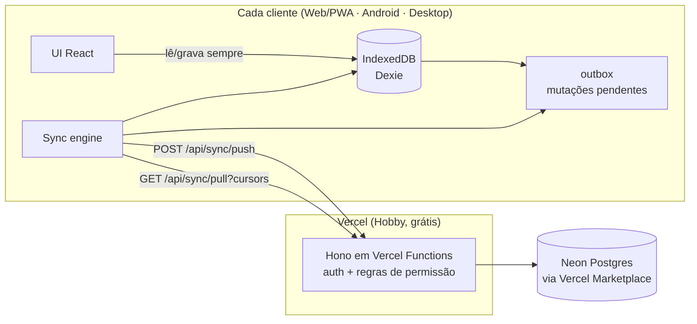

# Dados, sincronização e offline

## 1. Visão geral



**Princípio:** a UI **nunca** fala com a API diretamente para dados de músicas/repertórios. Ela lê e grava no banco local; o *sync engine* leva as mudanças para o servidor e traz as dos outros dispositivos/membros. Por isso o app é offline por padrão (RF-40), não um "modo" que se liga.

## 2. Banco no servidor — Neon Postgres (via Vercel)

- **Por que Neon:** o antigo "Vercel Postgres" foi migrado para a Neon; hoje a Vercel oferece Postgres pelo **Marketplace → Storage → Neon**, que cria o banco e injeta `DATABASE_URL` nas variáveis de ambiente do projeto automaticamente. Plano gratuito: ~0,5 GB por projeto e cota mensal de compute com *scale to zero* (conferir valores atuais na hora de criar).
- **Cabe folgado:** uma música tem ~3–8 KB de texto → 0,5 GB ≈ 60 mil+ músicas.
- **Driver:** `@neondatabase/serverless` (HTTP/WebSocket, ideal para funções serverless) + **Drizzle ORM** (schema em TS, migrations SQL versionadas no repo).
- **Cold start:** o banco "dorme" após minutos sem uso e acorda em centenas de ms — irrelevante para um app offline-first.

### Schema (Drizzle → Postgres)

Tabelas de autenticação do **Better Auth**: `user` (+ coluna `username` única, plugin *username*), `session`, `account`, `verification`.

Colunas comuns a **toda tabela sincronizada**:

| Coluna | Tipo | Função |
|---|---|---|
| `id` | `uuid` | Gerado **no cliente** (UUID v7) → criar offline sem colisão |
| `version` | `int` | Incrementa a cada escrita aceita (controle de conflito) |
| `seq` | `bigint` | Valor de uma `SEQUENCE` global, atribuído por trigger em todo INSERT/UPDATE → **cursor de sync** monotônico (sem depender de relógio) |
| `deleted` | `bool` | *Tombstone*: exclusão vira `deleted = true` para propagar aos outros dispositivos (limpeza física após 90 dias por job/cron) |
| `updated_at` | `timestamptz` | Do servidor, informativo |
| `updated_by_device` | `text` | Para nomear cópias de conflito |

Tabelas de domínio:

```text
songs            (id, owner_id → user, title, artist, key, capo, transpose, style, bpm,
                  duration_sec, scroll_speed, content TEXT, chord_prefs JSONB, notes, + comuns)
setlists         (id, owner_id, name, event_date, notes, + comuns)
setlist_items    (id, setlist_id, kind 'song'|'moment', song_id NULL, label NULL,
                  position TEXT  -- fractional index, transpose NULL, note, + comuns)
groups           (id, owner_id, name, + comuns)
group_members    (id, group_id, user_id, role 'owner'|'editor'|'member',
                  status 'pending'|'active', + comuns)   UNIQUE(group_id, user_id)
group_setlists   (id, group_id, setlist_id, added_by, + comuns)   UNIQUE(group_id, setlist_id)
user_settings    (id, user_id, device_id NULL, data JSONB, + comuns)  -- NULL = global
```

Índices: `(owner_id, seq)` em cada tabela de domínio, `(group_id, seq)` em `group_members`/`group_setlists`, `(setlist_id, seq)` em `setlist_items`, `user(username)` com `text_pattern_ops` para busca por prefixo.

**Ordenação de repertório com `position` fracionária** (lib `fractional-indexing`): mover uma música gera **uma** escrita (só o item movido), então dois membros reordenando ao mesmo tempo não se atropelam.

## 3. Banco local — IndexedDB via Dexie

- **Mesmo código nas 3 plataformas:** IndexedDB existe no navegador, no WebView2 (Windows), no WebKitGTK (Linux) e no WebView do Android.
- Tabelas espelho (`songs`, `setlists`, `setlist_items`, `groups`, `group_members`, `group_setlists`, `user_settings`) + `profiles` (id, username, nome — dos membros dos grupos) + `outbox` + `meta` (cursores, device_id, usuário logado).
- Índices Dexie para a biblioteca: `title`, `artist`, `key`, `[owner_id+deleted]`; busca de trecho de letra com índice invertido simples (tokens normalizados sem acento) gerado ao salvar.
- `useLiveQuery` (dexie-react-hooks) → a UI reage sozinha quando o sync grava dados novos.
- **Persistência garantida:** `navigator.storage.persist()` na web; no Tauri/Capacitor o armazenamento do WebView já é persistente. Backup JSON exportável (RF-13) como rede de segurança.

## 4. Protocolo de sincronização

### Push — `POST /api/sync/push`

```json
{ "deviceId": "…", "mutations": [
  { "mid": "uuid", "table": "songs", "op": "upsert", "id": "…", "baseVersion": 3, "data": { … } },
  { "mid": "uuid", "table": "setlist_items", "op": "delete", "id": "…", "baseVersion": 1 }
]}
```

- Cliente grava a mudança localmente **e** enfileira na `outbox` na mesma transação Dexie.
- Servidor processa em **uma transação**, mutação por mutação:
  1. **Autorização** (seção 5). Negada → `rejected` (cliente reverte o registro local puxando a versão do servidor).
  2. Linha inexistente → insere com `version = 1`.
  3. `baseVersion == version atual` → aplica, `version + 1`.
  4. **Conflito** (`baseVersion` antigo) → política por tabela:
     - `songs`: se `content` divergiu, **ninguém perde nada**: aplica a versão mais recente pelo servidor e cria uma **cópia de conflito** ("Título (conflito – Celular)") com o outro conteúdo; metadados simples (título, tom, capo) usam *last-write-wins* por campo.
     - `setlists`, `setlist_items`, `user_settings`, `groups`: *last-write-wins* por campo (campos alterados na mutação sobrescrevem; os demais ficam).
     - `delete` × `update`: update vence se veio depois; senão permanece apagado.
- Idempotência: `mid` (id da mutação) guardado por 7 dias numa tabela `applied_mutations` → reenvio após queda de rede não duplica.
- Resposta: resultado por `mid` (`ok` | `conflict` | `rejected`) + novas `version`/`seq`.

### Pull — `GET /api/sync/pull`

O cliente mantém **um cursor por escopo**:

- `me` → tudo de que o usuário é dono (`owner_id = eu`) + `user_settings` dele.
- `group:<id>` → para cada grupo ativo: `groups`, `group_members`, `profiles` dos membros, `group_setlists`, `setlist_items` desses repertórios, os `setlists` e as **músicas referenciadas** por esses itens.

Por que vários cursores: quando o usuário **entra num grupo**, aquele escopo começa do cursor `0` e baixa tudo do grupo, mesmo o que foi criado meses antes; os outros escopos não são reenviados.

Detalhe para músicas de grupo: uma música antiga adicionada hoje a um repertório do grupo tem `seq` antigo. A query do escopo de grupo devolve músicas onde **`song.seq > cursor` OU o `setlist_item` que a referencia tem `seq > cursor`**.

Resposta paginada (até 500 linhas por página, `hasMore`), com o novo cursor = maior `seq` entregue. Saída do grupo/remoção → o servidor responde `revokedScopes: ["group:<id>"]` e o cliente apaga localmente o que só existia por aquele grupo.

### Quando sincroniza (RF-41)

Ao abrir o app · ao fazer login · evento `online` · 2 s após a última edição local (debounce) · a cada 60 s com o app em primeiro plano · ao entrar no modo palco de um repertório de grupo · botão manual. Ordem sempre **push → pull**. Sem WebSocket (Vercel Functions não mantêm conexões longas e o plano grátis não precisa disso): "tempo real" do grupo = polling de 60 s, ou 15 s enquanto a tela de um repertório de grupo estiver aberta. Custo da chamada vazia: 1 query indexada.

Indicador na barra: ✅ sincronizado · 🔄 sincronizando · ⏳ N alterações pendentes (offline) · ⚠️ erro (com detalhe).

## 5. Grupos e permissões (aplicadas **no servidor**)

| Ação | Quem pode |
|---|---|
| Criar grupo | Qualquer usuário (limite: 10 grupos criados, 30 membros por grupo — protege a cota grátis) |
| Convidar/remover membro, mudar papel | `owner` |
| Sair do grupo | Qualquer membro (o owner precisa transferir antes) |
| Compartilhar um repertório no grupo | `owner`/`editor` que é **dono do repertório** |
| Editar repertório compartilhado (itens, ordem, tons) | Dono do repertório + `editor`s do grupo |
| Remover repertório do grupo | Quem adicionou ou `owner` |
| Ler repertório e músicas do grupo | Todos os membros `active` |
| Editar uma música | **Só o dono da música** (membros podem "copiar para minha biblioteca" — RF-27) |

- **Convite pelo nome de usuário** (RF-24): `GET /api/users/search?q=joa` (prefixo, mín. 3 caracteres, máx. 10 resultados, devolve só `id`, `username`, `nome`, com rate limit) → `owner` cria `group_members` com `status = 'pending'` → convidado aceita/recusa na tela *Grupos* (RF-28; no MVP pode entrar direto como `active`).
- Ao adicionar ao repertório de grupo uma música privada do dono, ela passa a ser legível pelos membros (sem cópia).

## 6. Autenticação entre plataformas

- **Better Auth** (open source, roda dentro da própria API Hono, usa as tabelas do Postgres): e-mail + senha, plugin `username`, plugin `bearer`.
- **Web:** cookie de sessão `HttpOnly` (mesma origem que a API).
- **Android/Desktop:** o WebView roda em outra origem (`https://localhost` no Capacitor, `tauri://localhost`/`http://tauri.localhost` no Tauri) → usam **token Bearer** guardado localmente (Capacitor Preferences / Tauri Store). CORS da API libera exatamente essas origens.
- Sessão longa (60 dias, renovada a cada uso) para o músico não ser deslogado no dia do show sem internet; o app continua funcionando offline com sessão expirada e só pede login ao sincronizar.
- `deviceId` (UUID gerado na 1ª abertura) identifica o dispositivo para conflitos e configurações por dispositivo.
