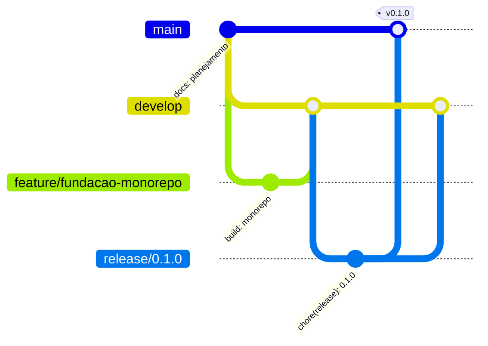

# Versionamento

## Conventional Commits

| Tipo | Uso | Efeito na versão (SemVer) |
|---|---|---|
| `feat` | nova funcionalidade | MINOR |
| `fix` | correção de bug | PATCH |
| `feat!` / rodapé `BREAKING CHANGE:` | quebra de compatibilidade (ex.: formato de dados ou de sincronização) | MAJOR |
| `perf` | melhoria de desempenho | PATCH |
| `docs` | documentação, specs, prompts | — |
| `refactor` | mudança interna sem alterar comportamento | — |
| `test` | testes | — |
| `build` | dependências, empacotamento | — |
| `ci` | pipelines | — |
| `chore` | manutenção geral | — |
| `style` | formatação | — |

**Escopos sugeridos:** `core`, `editor`, `acordes`, `repertorios`, `grupos`, `palco`, `sync`, `api`, `db`, `web`, `desktop`, `android`, `ci`, `deps`, `docs`, `adr`, `specs`, `prompts`, `release`.

**Exemplos**

- `feat(palco): adiciona modo de rolagem híbrida`
- `fix(sync): evita duplicar mutação reenviada após queda de rede`
- `docs(specs): adiciona SPEC da fundação do produto`

## Branches e releases

O projeto usa **git flow desde o início**, inclusive durante o MVP. A única exceção são os commits de documentação feitos antes da `develop` existir: o planejamento inicial (SPEC/PLAN/TASKS do MVP) e o próprio bootstrap do repositório.

### Git flow



| Branch | Sai de | Volta para | Uso |
|---|---|---|---|
| `main` | — | — | Só versões publicadas; cada merge tem uma tag `vX.Y.Z`; produção na Vercel |
| `develop` | `main` (uma vez, logo após o push inicial) | — | Integração das features; preview da Vercel como homologação |
| `feature/<nome>` | `develop` | `develop` (PR, **squash**) | Uma unidade de trabalho. No MVP, os nomes de branch são os indicados em cada fase do `TASKS.md`. Nas features seguintes, `feature/NN-nome`, com SPEC/PLAN/TASKS aprovados no mesmo PR que o código |
| `release/X.Y.Z` | `develop` | `main` **e** `develop` (PR, **merge commit**, sem squash) | Congela a versão: roda `commit-and-tag-version`, só aceita `fix:`/`docs:`; a tag vai no commit de merge na `main` |
| `hotfix/X.Y.Z` | `main` | `main` **e** `develop` (merge commit) | Correção urgente em produção; incrementa o PATCH |

**Regras**

- `main` e `develop` ficam **protegidas**: não aceitam push direto, só PR com CI verde.
- O título de todo PR segue Conventional Commits, porque é ele que vira o commit no squash.
- Nomes de branch em minúsculas com hífens, por exemplo `feature/02-importar-pdf` e `hotfix/1.1.1`.
- Uma feature por branch. Se uma feature depender de outra, a segunda começa depois do merge da primeira na `develop`.
- Depois de mergear uma `release/*` ou `hotfix/*` na `main`, o merge de volta na `develop` é **obrigatório** antes de abrir outra release.
- **Quem mergeia:**
  - **Claude:** PRs de `feature/*` → `develop`, depois do CI verde.
  - **Autor:** PRs de `release/*` e `hotfix/*` → `main`, porque publicam versões.

### Geração de versão

O **`commit-and-tag-version`** lê os Conventional Commits desde a última tag. Antes da `1.0.0`, mudanças que quebram compatibilidade sobem o MINOR.

**Release:**
1. Criar `release/X.Y.Z` a partir da `develop`. Para saber o X.Y.Z, rodar `pnpm release --dry-run` na `develop`.
2. Rodar `pnpm release --skip.tag` na branch de release. Isso atualiza o `CHANGELOG.md` e as versões (web, Tauri, Android) e cria o commit `chore(release): X.Y.Z`. A tag fica para depois.
3. Abrir PR `release/X.Y.Z` → `main` e mergear com **merge commit**.
4. Criar a tag `vX.Y.Z` **no commit de merge da `main`** e enviá-la. O push da tag dispara o workflow que publica a GitHub Release com os instaladores.
5. Mergear a `main` de volta na `develop` e apagar a branch de release.

**Hotfix:** mesmo procedimento, partindo da `main` em `hotfix/X.Y.Z`. O passo 2 incrementa o PATCH.

## Autoria com IA

O projeto é do autor e feito com auxílio de IA. Commits produzidos com a IA terminam com:

```
Co-Authored-By: Claude <noreply@anthropic.com>
```

Os prompts que originaram cada etapa ficam em [`docs/prompts/`](../prompts/README.md).
