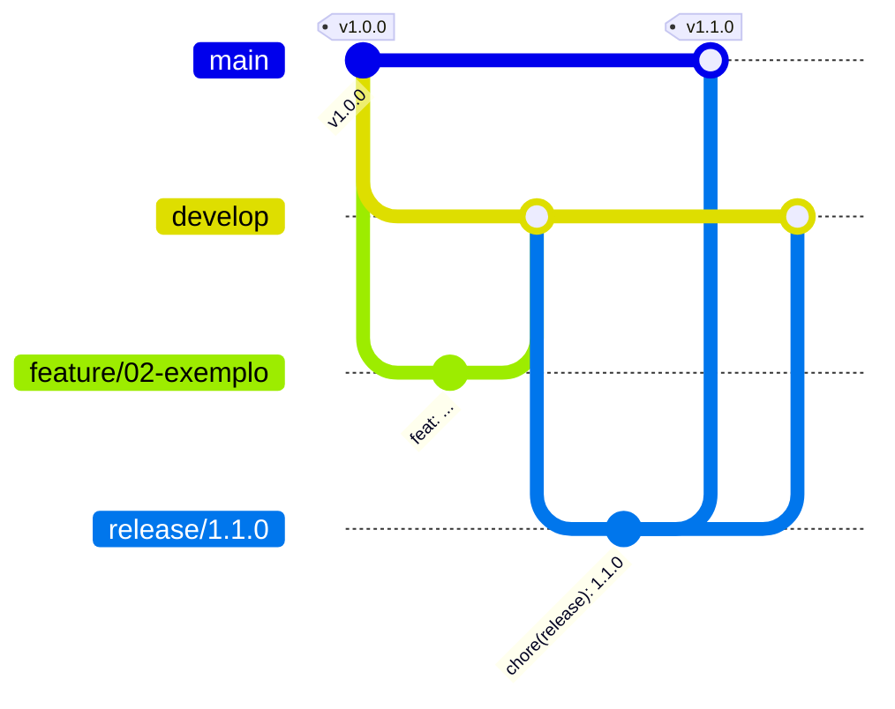

# Versionamento

## Conventional Commits

| Tipo | Uso | Efeito na versão (SemVer) |
|---|---|---|
| `feat` | nova funcionalidade | MINOR |
| `fix` | correção de bug | PATCH |
| `feat!` / rodapé `BREAKING CHANGE:` | quebra de compatibilidade (ex.: formato de dados ou de sincronização) | MAJOR |
| `perf` | melhoria de desempenho | PATCH |
| `docs` | documentação, specs, prompts | — |
| `refactor` | mudança interna sem alterar comportamento | — |
| `test` | testes | — |
| `build` | dependências, empacotamento | — |
| `ci` | pipelines | — |
| `chore` | manutenção geral | — |
| `style` | formatação | — |

**Escopos sugeridos:** `core`, `editor`, `acordes`, `repertorios`, `grupos`, `palco`, `sync`, `api`, `db`, `web`, `desktop`, `android`, `ci`, `docs`, `specs`, `prompts`.

**Exemplos**

- `feat(palco): adiciona modo de rolagem híbrida`
- `fix(sync): evita duplicar mutação reenviada após queda de rede`
- `docs(specs): adiciona SPEC da fundação do produto`

## Branches e releases

O projeto tem dois momentos:

| Momento | Fluxo |
|---|---|
| **MVP** ([`specs/01-mvp`](../specs/01-mvp/SPEC.md), até a `v1.0.0`) | Trabalho direto na **`main`**. Cada fase do PLAN termina com uma release gerada na própria `main`. |
| **Depois da `v1.0.0`** | **Git flow padrão** para tudo: features, releases e correções. |

### Geração de versão (os dois momentos)

O **`commit-and-tag-version`** lê os Conventional Commits desde a última tag e:

- calcula a próxima versão (SemVer);
- atualiza o `CHANGELOG.md` e as versões do app web, do Tauri e do Android;
- cria o commit `chore(release): X.Y.Z` e a tag `vX.Y.Z`.

O push da tag dispara o workflow que publica a GitHub Release com os instaladores.

Antes da `1.0.0`, mudanças que quebram compatibilidade sobem o MINOR.

### Git flow (após o MVP)



| Branch | Sai de | Volta para | Uso |
|---|---|---|---|
| `main` | — | — | Só versões publicadas; cada merge tem uma tag `vX.Y.Z`; produção na Vercel |
| `develop` | `main` (uma vez, ao fechar a `v1.0.0`) | — | Integração das features; preview da Vercel como homologação |
| `feature/NN-nome` | `develop` | `develop` (PR, **squash**) | Uma feature SDD (`docs/specs/NN-nome/`). O PR leva SPEC/PLAN/TASKS aprovados e o código |
| `release/X.Y.Z` | `develop` | `main` **e** `develop` (PR, **merge commit**, sem squash) | Congela a versão: roda `commit-and-tag-version`, só aceita `fix:`/`docs:`; a tag vai no commit de merge na `main` |
| `hotfix/X.Y.Z` | `main` | `main` **e** `develop` (merge commit) | Correção urgente em produção; incrementa o PATCH |

**Regras**

- `main` e `develop` ficam **protegidas**: não aceitam push direto, só PR com CI verde.
- O título de todo PR segue Conventional Commits, porque é ele que vira o commit no squash.
- Nomes de branch em minúsculas com hífens, por exemplo `feature/02-importar-pdf` e `hotfix/1.1.1`.
- Uma feature por branch. Se uma feature depender de outra, a segunda começa depois do merge da primeira na `develop`.
- Depois de mergear uma `release/*` ou `hotfix/*` na `main`, o merge de volta na `develop` é **obrigatório** antes de abrir outra release.

## Autoria com IA

O projeto é do autor e feito com auxílio de IA. Commits produzidos com a IA terminam com:

```
Co-Authored-By: Claude <noreply@anthropic.com>
```

Os prompts que originaram cada etapa ficam em [`docs/prompts/`](../prompts/README.md).
