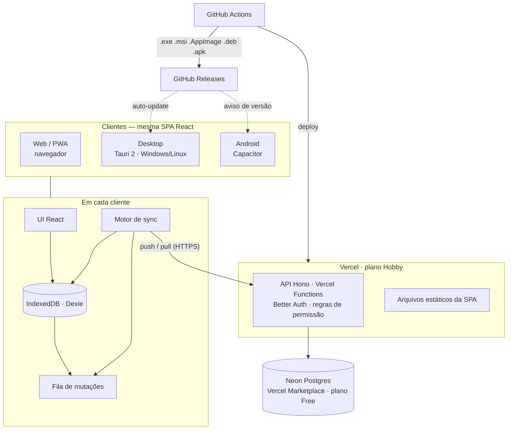

# PLAN: CifraSync — produto inicial (MVP multiplataforma)

**Status:** Aprovado (2026-11-20)
**Data:** 2026-11-20
**SPEC:** [SPEC.md](SPEC.md) (aprovada)

## Abordagem

Todo o app é **uma única aplicação web (SPA React)** escrita uma vez. Ela é distribuída de três formas:

- servida pela **Vercel** como site/PWA;
- empacotada pelo **Tauri 2** como instalador para Windows e Linux;
- empacotada pelo **Capacitor** como APK Android.

A mesma Vercel hospeda uma **API leve (Hono)** em funções serverless. Essa API usa o **Postgres da Neon**, criado pelo Marketplace/Storage da Vercel.

Cada cliente é **offline-first**: lê e grava num banco local (IndexedDB), e um **motor de sincronização próprio** troca mudanças com a API (push de uma fila de mutações + pull por cursores). Toda a lógica musical (parser de cifra, transposição, acordes) fica num pacote TypeScript puro e testado, compartilhado por todas as plataformas.

Os executáveis são gerados pelo **GitHub Actions** e publicados nas **GitHub Releases**. A versão vem dos **Conventional Commits**.

## Comportamento atual → esperado

- **Atual:** o repositório só tem documentação, sem código, CI ou infraestrutura.
- **Esperado:** um monorepo com o app funcionando nas 3 plataformas, API e banco na Vercel, CI e releases automáticos, atendendo aos critérios de aceitação da SPEC.

## Arquitetura

### Stack

| Camada | Escolha | Motivo |
|---|---|---|
| Linguagem | TypeScript strict (+ Rust mínimo no Tauri) | Um idioma para domínio, UI e API |
| Monorepo | pnpm workspaces + Turborepo | Pacotes compartilhados e cache de build |
| UI | React + Vite + React Router + Tailwind CSS + Radix UI | SPA estática embutível no Tauri e no Capacitor |
| Editor de cifra | CodeMirror 6 com destaque próprio | Monoespaçado, rápido, funciona no celular |
| PWA | vite-plugin-pwa (Workbox) | Site abre offline e é instalável |
| Banco local | IndexedDB via Dexie (+ consultas reativas) | Idêntico no navegador, WebView2, WebKitGTK e WebView Android |
| API | Hono em Vercel Functions (Node) | Leve, nativo na Vercel, portátil para outros hosts |
| Autenticação | Better Auth (e-mail/senha, nome de usuário, token bearer) | Open source, gratuito, dados no próprio Postgres |
| Banco servidor | Neon Postgres via Vercel + Drizzle ORM + driver serverless da Neon | É o Postgres oferecido pela Vercel, com plano grátis |
| Validação | Zod (schemas compartilhados entre cliente e API) | Um contrato só |
| Desktop | Tauri 2 | Instaladores pequenos, Windows + Linux, updater gratuito via GitHub |
| Android | Capacitor | APK a partir da mesma SPA, plugins maduros |
| Testes | Vitest (unidade/integração), Playwright (e2e web) | — |
| Qualidade | ESLint, Prettier, typecheck, commitlint + Husky | — |
| Releases | commit-and-tag-version + tauri-action + Gradle no Actions | Versão e CHANGELOG a partir dos commits, compatível com git flow |

## Componentes afetados

Todos novos. Estrutura do monorepo:

| Caminho | Responsabilidade |
|---|---|
| `packages/core` | Domínio musical puro: parser de cifra (AST), formatação automática, parser de acordes BR/internacional, transposição com grafia e realinhamento, capo, detecção de tom, dados de acordes e gerador de posições, conversão ChordPro. Sem dependência de UI ou rede. |
| `packages/shared` | Tipos e schemas Zod das entidades e do protocolo de sync; constantes (limites, papéis). |
| `packages/sync` | Schema do banco local, fila de mutações, motor de sync (push → pull, cursores por escopo, conflitos, revogação), estado do indicador de sync. |
| `apps/web` | A SPA: biblioteca, editor, dicionário de acordes, repertórios, grupos, modo palco, configurações, login. Camada `platform` com adaptadores web/desktop/android (tela ligada, tela cheia, orientação, armazenamento do token, arquivos, atualização). |
| `apps/web/api` + `apps/web/server` | API Hono: autenticação, `sync/push`, `sync/pull`, busca de usuários, convites, exportação, exclusão de conta. Schema Drizzle e migrations SQL versionadas. |
| `apps/desktop` | Projeto Tauri 2 que carrega o build da SPA; comandos nativos de tela ligada, armazenamento seguro do token e updater. |
| `apps/android` | Projeto Capacitor que carrega o build da SPA; plugins de tela ligada, orientação, barra de status, preferências e compartilhamento de arquivos. |
| `.github/workflows` | CI, migrations e build de release. |
| `docs/adr` | ADRs das decisões abaixo, criados quando este PLAN for aprovado. |

**Camadas tocadas:** UI ↔ banco local ↔ motor de sync ↔ API ↔ Postgres.

**Concorrência / o que não pode bloquear:**
- **Thread de UI:** sync, parsing e paginação de músicas longas nunca bloqueiam a interação. O sync roda assíncrono, em lotes, e o layout do palco é memoizado e pré-calculado para a próxima música.
- **Modo palco:** uma escrita do sync no banco local **não** re-renderiza a música em execução. As mudanças ficam pendentes e são aplicadas ao trocar de música (SPEC §6).
- **Fila de mutações:** gravação local e enfileiramento acontecem na **mesma transação** do IndexedDB, para nunca ficar dado salvo sem ir para a fila.
- **Servidor:** cada push é processado numa **transação única** do Postgres. Mutações reenviadas são idempotentes (id da mutação registrado).
- **Uma sincronização por vez:** um lock por aba/janela impede duas execuções simultâneas do motor de sync no mesmo dispositivo.

## Mudanças de dados/API

### Banco servidor (Postgres)

- **Autenticação:** tabelas do Better Auth (`user` com `username` único, `session`, `account`, `verification`).
- **Domínio:**

  | Tabela | Conteúdo |
  |---|---|
  | `songs` | Metadados, conteúdo cifrado em texto, capo, transposição preferida, velocidade/duração de rolagem, preferências de posição de acorde |
  | `setlists` | Repertórios |
  | `setlist_items` | Itens do tipo música ou momento, com posição em índice fracionário e tom próprio |
  | `groups` | Grupos |
  | `group_members` | Papel `owner`/`editor`/`member` e status `pending`/`active` |
  | `group_setlists` | Repertórios compartilhados com cada grupo |
  | `user_settings` | Configurações globais ou por dispositivo |
  | `applied_mutations` | Idempotência do push, com limpeza periódica |

- **Colunas comuns de sincronização:**

  | Coluna | Função |
  |---|---|
  | `id` | UUID v7 gerado no cliente |
  | `version` | Controle de conflito |
  | `seq` | Valor de uma sequência global atribuído por trigger; usado como cursor |
  | `deleted` | Tombstone de exclusão |
  | `updated_at` | Data/hora da última alteração |
  | `updated_by_device` | Dispositivo que fez a última alteração |

- **Índices:** por dono + `seq`, por grupo + `seq`, por repertório + `seq`, e busca por prefixo em `username`.
- **Detalhamento:** [contexto/sincronizacao-offline.md](../../contexto/sincronizacao-offline.md) §2.

### Banco local (IndexedDB)

- Espelho das tabelas acima, mais perfis dos membros de grupo, fila de mutações e metadados (cursores, id do dispositivo, sessão).
- Índice de busca por trecho de letra, normalizado sem acentos.

### API (`/api`)

| Rota | Função |
|---|---|
| `auth/*` | Cadastro, login, logout, sessão, emissão de token bearer |
| `sync/push` | Lote de mutações. Resultado por mutação: ok, conflito (com cópia de conflito para letras) ou rejeitado |
| `sync/pull` | Mudanças desde os cursores de cada escopo (próprio + um por grupo), paginadas. Lista também os escopos revogados |
| `users/search` | Busca por prefixo do nome de usuário: mín. 3 caracteres, máx. 10 resultados, com limite de requisições |
| `groups/:id/invites`, `invites/:id/accept`, `invites/:id/decline` | Convites |
| `export` | Backup JSON completo da conta |
| `account` (DELETE) | Excluir a conta |
| `health` | Status |

- Toda escrita de domínio passa por `sync/push`, o que deixa um único ponto de autorização.
- Tabela de permissões: SPEC §4.

### Autenticação entre plataformas

- **Web:** cookie de sessão HttpOnly (mesma origem).
- **Desktop e Android:** token bearer guardado localmente. O CORS libera só as origens do Tauri e do Capacitor.
- Sessão longa (60 dias, renovada a cada uso), para não deslogar offline.

## Executáveis e distribuição

| Plataforma | Ferramenta | Artefatos | Distribuição | Atualização |
|---|---|---|---|---|
| Web | Vite + PWA | Site em `*.vercel.app` | Vercel (deploy a cada merge em `main`; preview por PR) | Automática (service worker) |
| Windows 10/11 | Tauri 2 (WebView2) | Instalador NSIS `.exe` e `.msi` | GitHub Releases | Plugin updater do Tauri, assinado com chave própria gratuita |
| Linux | Tauri 2 (WebKitGTK) | `.AppImage` e `.deb` | GitHub Releases | Updater no AppImage; `.deb` manual |
| Android 7+ | Capacitor | `.apk` assinado com keystore própria | GitHub Releases (compatível com Obtainium) | Aviso no app quando há release nova |

Sem certificado pago de assinatura de código, o Windows mostra o aviso do SmartScreen e o Android pede permissão para instalar de fontes externas. O README vai documentar os dois casos.

## Custo zero

| Serviço | Plano | Uso | Limite relevante | Proteção |
|---|---|---|---|---|
| Vercel | Hobby | SPA, API e previews | Uso não comercial; cotas de funções e banda | Assets com cache longo; respostas comprimidas |
| Neon (via Vercel) | Free | Banco único | ~0,5 GB por projeto e cota mensal de compute com scale-to-zero (valores confirmados na criação) | Sync periódico só com o app em primeiro plano; backoff quando nada muda; pull indexado e paginado; limites de 10 grupos por usuário e 30 membros por grupo |
| GitHub | Free | Repo público, Actions, Releases | Actions ilimitado para repositório público | Manter o repositório público |
| Assinaturas | — | Keystore Android e chave do updater, geradas localmente | — | Backup obrigatório em 2 locais |

## Decisões dos pontos em aberto da SPEC

1. **Convite de grupo com aceite:** o convidado vê o convite e aceita ou recusa (`pending` → `active`). O custo é baixo, e isso evita que alguém seja colocado num grupo sem consentimento.
2. **Região:** funções na região `gru1` (São Paulo) e banco na região AWS São Paulo, se o plano gratuito oferecer na criação. Se não oferecer, as duas ficam em `us-east-1`/`iad1`, juntas. Como o app é offline-first, a latência não afeta o uso no palco.
3. **Banco para desenvolvimento:**
   - **Local:** um branch `dev` do Neon. É gratuito e não exige instalar nada.
   - **CI:** Postgres em contêiner de serviço do Actions, para os testes de integração do sync.
   - **Previews da Vercel:** usam o branch `dev`.

## Fases de entrega

Cada fase termina num estado utilizável, com uma release semântica. O TASKS.md vai detalhar cada fase em tarefas de 1 a 3 horas.

| Fase | Entrega | Release |
|---|---|---|
| 0 | Monorepo, lint/typecheck/test, commitlint/Husky, CI, geração de versão, ADRs | `v0.1.0` |
| 1 | `packages/core` completo e testado (cifra, acordes, transposição, capo, posições) | `v0.2.0` |
| 2 | SPA local sem servidor: biblioteca, editor, dicionário, repertórios, PWA offline | `v0.3.0` |
| 3 | Modo palco: paginação, rolagem automática/híbrida, coluna de acordes, personalização | `v0.4.0` |
| 4 | Vercel + Neon, autenticação, API de sync, motor de sync no cliente | `v0.5.0` |
| 5 | Grupos: busca por usuário, convites, papéis, compartilhamento, revogação | `v0.6.0` |
| 6 | Desktop Tauri (Windows/Linux) com updater e build na release | `v0.7.0` |
| 7 | Android Capacitor com APK assinado na release | `v0.8.0` |
| 8 | Polimento (export/import, configurações por dispositivo, acessibilidade, revisão de segurança) → critérios da SPEC verificados → criação da `develop` e proteção das branches (início do git flow) | `v1.0.0` |

## Divisão de trabalho: Claude × autor

### Claude faz sozinho

- Todo o código: pacotes, SPA, API, schema e migrations, configuração do Tauri e do Capacitor.
- Testes unitários, de integração e e2e, com cifras de teste autorais ou de domínio público.
- Workflows do Actions, configuração da Vercel, `.env.example` e scripts de versão (versão única sincronizada entre web, Tauri e Gradle).
- Documentação: ADRs, README, CHANGELOG (via commit-and-tag-version), registro dos prompts.
- Commits semânticos e descrições de PR.
- Comandos prontos para cada passo humano abaixo.

### Precisa do autor

| Fase | Ação | Por quê |
|---|---|---|
| 0 | Criar o repositório público `CifraSync` no GitHub e autorizar o push | Conta do autor |
| 4 | Criar conta na Vercel, importar o repositório, criar o banco Neon em *Storage*, cadastrar `BETTER_AUTH_SECRET` | Aceite de termos e criação de recursos na conta do autor |
| 4 | Cadastrar no GitHub o secret da URL direta do banco, usado nas migrations | Credencial |
| 6 | Guardar a chave privada do updater e cadastrar os secrets do Tauri | Credencial; se perdida, o app instalado não atualiza mais |
| 7 | Gerar e guardar a keystore Android e cadastrar os secrets de assinatura | Credencial; se perdida, os usuários precisam reinstalar |
| 6–7 | Instalar Rust e Android Studio, se quiser compilar localmente | Instalação na máquina do autor |
| 1 | Validar as posições de cavaco e ukulele geradas | Conhecimento prático do instrumento |
| 2–7 | Testar em aparelhos reais e num ensaio | Hardware, legibilidade, ergonomia |
| 5 | Testar grupo com uma segunda pessoa real | Exige outra conta |
| Todas | Aprovar cada etapa e revisar/mergear PRs | Controle do projeto |

## Versionamento e CI/CD

- **Commits:** Conventional Commits em português, validados no hook `commit-msg` e no título do PR ([versionamento](../../processo/versionamento.md)).
- **Fluxo de branches em dois momentos:**

  | Momento | Fluxo |
  |---|---|
  | **Durante este MVP (até `v1.0.0`)** | Trabalho direto na `main`. Cada fase termina com uma release gerada na própria `main`. |
  | **Depois da `v1.0.0` (toda feature seguinte)** | **Git flow padrão:** criar a `develop` a partir da `main`, proteger `main` e `develop`, e seguir o ciclo descrito abaixo. |

  Ciclo do git flow:
  - `feature/NN-nome` sai da `develop` e volta para ela por PR.
  - `release/X.Y.Z` sai da `develop`, recebe o bump de versão e o CHANGELOG, é mergeada na `main` com a tag e volta para a `develop`.
  - `hotfix/X.Y.Z` sai da `main` e volta para a `main` e para a `develop`.

  O detalhe está em [versionamento](../../processo/versionamento.md#git-flow-após-o-mvp).
- **Geração de versão:** **`commit-and-tag-version`** calcula a próxima versão pelos Conventional Commits, atualiza o CHANGELOG e as versões (web, Tauri, Gradle), cria o commit `chore(release): X.Y.Z` e a tag `vX.Y.Z`.
  - No MVP, roda na `main`. No git flow, roda dentro da branch `release/*` ou `hotfix/*`.
  - Substitui o release-please, que exige uma branch única de release e conflita com o git flow.
- **Workflows:**

  | Workflow | Gatilho | Faz |
  |---|---|---|
  | `ci` | Push em `main`, `develop`, `feature/*`, `release/*`, `hotfix/*` e PRs | Lint, typecheck, testes (com Postgres de serviço), build da SPA, commitlint |
  | `migrate` | Push em `main` com mudança em migrations | Aplica migrations em produção |
  | Vercel (integração Git) | Push/PR | Produção a partir da `main`; previews de qualquer outra branch e PR (inclusive a `develop`, que serve de homologação) |
  | `release-build` | Push de tag `v*` | Cria a GitHub Release com as notas do CHANGELOG e anexa os artefatos da matriz Windows + Linux (Tauri) e Android (Gradle) e o manifesto do updater |

- **Autoria com IA:** trailer `Co-Authored-By` nos commits feitos com a IA, seção no README e prompts em `docs/prompts/`.

## Riscos

| Risco | Mitigação |
|---|---|
| Detecção automática de cifra errar em casos ambíguos | Classificação por pontuação, mais relatório no editor e correção manual por linha; suíte com ≥ 30 cifras reais (critério da SPEC) |
| Conflitos de sync perderem texto | Controle por `version`, cópia de conflito para letras, testes de dois dispositivos, exportação JSON |
| Diferenças do WebKitGTK (Linux) em relação ao Chromium | Playwright também em WebKit no CI; evitar APIs recentes sem fallback; adaptadores de plataforma |
| Android WebView sem Wake Lock API | Plugin nativo de tela ligada atrás da camada `platform` |
| Cota de compute do Neon consumida pelo polling | Polling só em primeiro plano, intervalo maior quando nada muda, pull barato |
| Membro que entra num grupo antigo não receber músicas antigas | Cursor por escopo de grupo começando do zero; músicas incluídas quando o item que as referencia muda |
| Perda da keystore ou da chave do updater | Checklist de backup nas Fases 6 e 7 |
| Plano Hobby da Vercel é não comercial | Projeto pessoal; se mudar, a API Hono migra para outro host gratuito sem reescrita |
| Paginação lenta em músicas longas no celular | Medição por blocos indivisíveis, memoização e pré-cálculo da próxima música; critério de < 100 ms verificado em aparelho real |

## Alternativas consideradas

| Alternativa | Por que foi descartada |
|---|---|
| Next.js para web + API | A SPA estática é mais simples de embutir no Tauri e no Capacitor; Next.js traria SSR sem benefício para um app offline-first |
| Electron no desktop | Instaladores de 80–150 MB contra cerca de 10 MB do Tauri |
| Tauri também no Android | O suporte mobile é mais novo e tem menos plugins prontos que o Capacitor |
| React Native ou Flutter | Exigiriam uma segunda base de UI para web/desktop ou abririam mão da paridade fácil |
| Supabase (também no Marketplace da Vercel) | Viável, mas o Neon é o Postgres "padrão" da Vercel, e auth/sync próprios evitam dependência de serviço extra |
| PowerSync ou ElectricSQL para sync | Um serviço a mais para manter dentro de planos grátis; o protocolo próprio é pequeno e cobre os casos da SPEC |
| SQLite nativo em cada plataforma | Três implementações de armazenamento; IndexedDB é único e suficiente para o volume de texto |
| WebSocket para tempo real dos grupos | Funções serverless não mantêm conexão; o polling atende o critério de 60 s |
